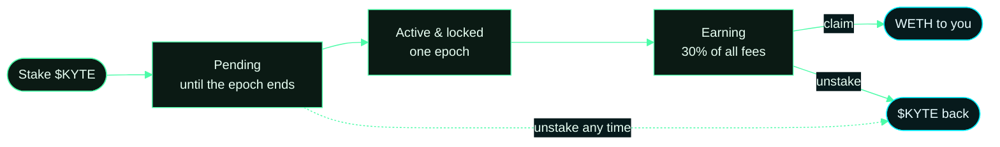

# Kyte StakingPool

The $KYTE staking pool and the fee path that feeds it: `FeeVault` collects every protocol fee, `StakingPool` pays
stakers their share in WETH, and `BuybackBurner` buys $KYTE on Uniswap v4 and burns it. The remaining sources in
`src/` are included so the project compiles and the tests run against the real markets.

## How staking works

- Stake $KYTE any time. New stake is **pending** until the current epoch (1 day) ends, then becomes **active**.
- Active stake earns its share of the epoch's fees, paid in WETH, claimable with `claim()`.
- Stake that just became active is locked for one full epoch. Pending stake can be unstaked at any time.
- Fee split, enforced on chain: 30% to stakers, 20% buyback and burn, 50% operations.

## A staker's journey



Fees arrive in WETH from the markets and the Uniswap v4 hook. Once per epoch the FeeVault splits them: 30% to this
pool, 20% to the BuybackBurner which buys $KYTE on Uniswap v4 and burns it, 50% to operations.

All protocol contracts: [usekyte-org/kyte-contract-v2](https://github.com/usekyte-org/kyte-contract-v2). The app:
[usekyte-org/Kyte-Market](https://github.com/usekyte-org/Kyte-Market). Listed tokens: [`MARKETS.md`](MARKETS.md).

## Live addresses

| Contract | Address |
|---|---|
| $KYTE token | [`0x072D88c2F31F568C0F4B8F613692eB489541Ed45`](https://robinhoodchain.blockscout.com/address/0x072D88c2F31F568C0F4B8F613692eB489541Ed45) |
| StakingPool | [`0xD7253a90fd43507F44cF0934F3D5d7432760d17f`](https://robinhoodchain.blockscout.com/address/0xD7253a90fd43507F44cF0934F3D5d7432760d17f) |
| BuybackBurner | [`0x8A9d128247D8c4512411CF9D0CdCAc5Acf86FB95`](https://robinhoodchain.blockscout.com/address/0x8A9d128247D8c4512411CF9D0CdCAc5Acf86FB95) |
| FeeVault | [`0x78c569A1137B78cB78F42c42B4B6C2b8F1E3dDef`](https://robinhoodchain.blockscout.com/address/0x78c569A1137B78cB78F42c42B4B6C2b8F1E3dDef) |
| Uniswap v4 swap adapter | [`0xFa17818515E946180b9767f9D9c40A09EE80dda6`](https://robinhoodchain.blockscout.com/address/0xFa17818515E946180b9767f9D9c40A09EE80dda6) |
| KyteHook (Uniswap v4) | [`0x77e52E93Aa0892b29a4527Af4f3a79F01cfa9044`](https://robinhoodchain.blockscout.com/address/0x77e52E93Aa0892b29a4527Af4f3a79F01cfa9044) |
| AssetRegistry (markets v2/v3) | [`0x02f571e10B9c7303EB7A6284A7137b146e18658D`](https://robinhoodchain.blockscout.com/address/0x02f571e10B9c7303EB7A6284A7137b146e18658D) |
| CallMarket (v3) | [`0xb6759D8893601BB7c1A032eC8ea40C856a6adf80`](https://robinhoodchain.blockscout.com/address/0xb6759D8893601BB7c1A032eC8ea40C856a6adf80) |
| PutMarket (v3) | [`0x2E2d5DfB4cf30d15688Cc2DDD30641c78DFfcb35`](https://robinhoodchain.blockscout.com/address/0x2E2d5DfB4cf30d15688Cc2DDD30641c78DFfcb35) |
| Router (v3) | [`0xdD76956667E6423bAC56d2EbF827a9b0d7dBDF68`](https://robinhoodchain.blockscout.com/address/0xdD76956667E6423bAC56d2EbF827a9b0d7dBDF68) |
| OptionNFT (v3) | [`0xE0CD21A7Ed37898A5ACdF7Dc68C52259Cd63308B`](https://robinhoodchain.blockscout.com/address/0xE0CD21A7Ed37898A5ACdF7Dc68C52259Cd63308B) |
| WETH | [`0x0Bd7D308f8E1639FAb988df18A8011f41EAcAD73`](https://robinhoodchain.blockscout.com/address/0x0Bd7D308f8E1639FAb988df18A8011f41EAcAD73) |
| Uniswap v4 PoolManager | [`0x8366a39CC670B4001A1121B8F6A443A643e40951`](https://robinhoodchain.blockscout.com/address/0x8366a39CC670B4001A1121B8F6A443A643e40951) |

## Build and test

```bash
pnpm install
forge build
forge test
```

Requires [Foundry](https://getfoundry.sh) and Node 24 with pnpm.

## Security

Report vulnerabilities to contact@kyte.sh. Please do not disclose publicly before we have responded.

Nothing here is investment advice. Kyte is built on Robinhood Chain and is not affiliated with or endorsed by Robinhood.
